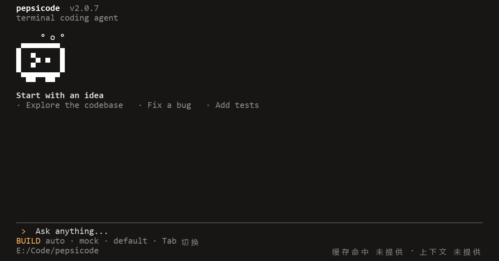
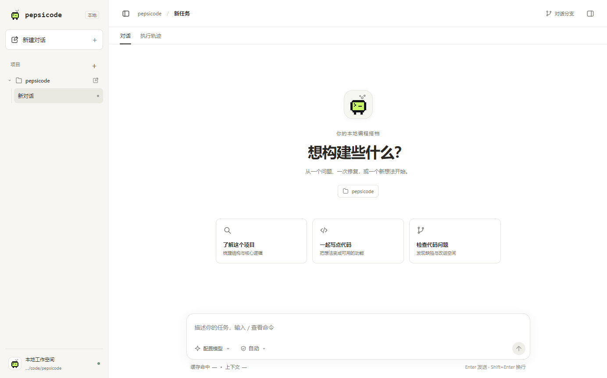

<div align="center">

<picture>
  <source media="(prefers-reduced-motion: reduce)" srcset="assets/logo.png">
  
</picture>

# pepsicode

**PepsiCode 是本地编程代理。** 在终端、桌面或 QQ 私聊中描述任务，它可以在项目里读代码、改文件、运行检查，并根据失败输出继续修复。

[](docs/development/release-candidate.md)


[](LICENSE)
[](docs/guides/configuration.md#模型配置)
[](https://github.com/peps1666/pepsicode/actions/workflows/ci.yml)

[快速开始](#快速开始) · [功能速览](#功能速览) · [文档](#文档) · [权限与安全](docs/guides/permissions.md) · [开发与验证](docs/development/development.md)

</div>

<div align="center">

<table>
  <tr>
    <td align="center" valign="top">
      <a href="assets/tui.png"></a>
      <br>
      <sub><b>终端 TUI</b></sub>
    </td>
    <td align="center" valign="top">
      <a href="assets/desktop-client.png"></a>
      <br>
      <sub><b>桌面客户端</b></sub>
    </td>
  </tr>
</table>

</div>

PepsiCode is a local coding agent for the terminal, desktop, and QQ. It can edit a project and run its checks under the permissions you select.

## 快速开始

安装 **Python 3.11+** 后，获取源码并启动终端界面。

```powershell
git clone https://github.com/peps1666/pepsicode.git
cd pepsicode
python -m pip install -e .
python -m pepsicode --install   # 首次配置服务商/模型
pepsicode
```

首次启动也可以直接输入 `/provider` 选择服务商、填写 API Key 和模型；配置会写入 `~/.pepsi-code/settings.json`。

用 `pepsicode --version` 查看本地版本和提交。Windows 便携包的解压、启动与故障排查见[快速上手指南](ONBOARDING.md)，发行包和验收记录见 [GitHub Releases](https://github.com/peps1666/pepsicode/releases)。

> 新会话默认使用自动审批。项目内编辑和常规开发命令可自动执行，高风险命令仍需确认。用 `/permissions` 查看或切换模式。见[权限与安全](docs/guides/permissions.md)。

### 接入 QQ 私聊

QQ 通道接受指定好友的文字私聊，可处理本地项目并在聊天中请求审批。接入需要 Node.js 22+、已配置的模型和已登录的 OneBot v11 网关。配置步骤及非官方网关的账号风险见 [QQ 接入指南](integrations/qq/README.md)。

## 功能速览

| 能力 | 说明 | 详情 |
| --- | --- | --- |
| 双前端 | 终端全屏 TUI + Electron 桌面客户端，共享代理内核与权限 | [桌面客户端](docs/guides/desktop.md) |
| 代码理解与修改 | LSP 导航、跨文件重命名、diff 先行的编辑工具族、搜索与文件树 | [功能与工作流](docs/guides/features.md#代码理解与修改) |
| 自动验证闭环 | 发现 tests / lint / build，失败回送模型修复，报告可追溯 | [质量闭环](docs/guides/features.md#质量闭环) |
| 权限与 Plan | 按会话选择审批模式。需要先审方案时进入 Plan，只读调查并写入计划文件 | [权限与安全](docs/guides/permissions.md) |
| 扩展与自动化 | Hooks v2、MCP、Skills、子代理、Markdown 自定义命令 | [Hooks v2](docs/guides/hooks.md) · [扩展](docs/guides/extensions.md) |
| QQ 私聊 | OneBot v11 通道，支持文字对话、任务排队、QQ 内审批及断线恢复 | [QQ 接入指南](integrations/qq/README.md) |
| 上下文与会话 | artifact、压缩、分支/恢复、持久记忆、成本与用量 | [模型、上下文与配置](docs/guides/configuration.md) |

## 文档

按用途查阅[文档导航](docs/README.md)。开发与测试从[设计与开发](docs/development/development.md)开始，当前限制和待验收项见[项目问题清单](docs/development/project-issues.md)。

## License

MIT，见 [LICENSE](LICENSE)。
