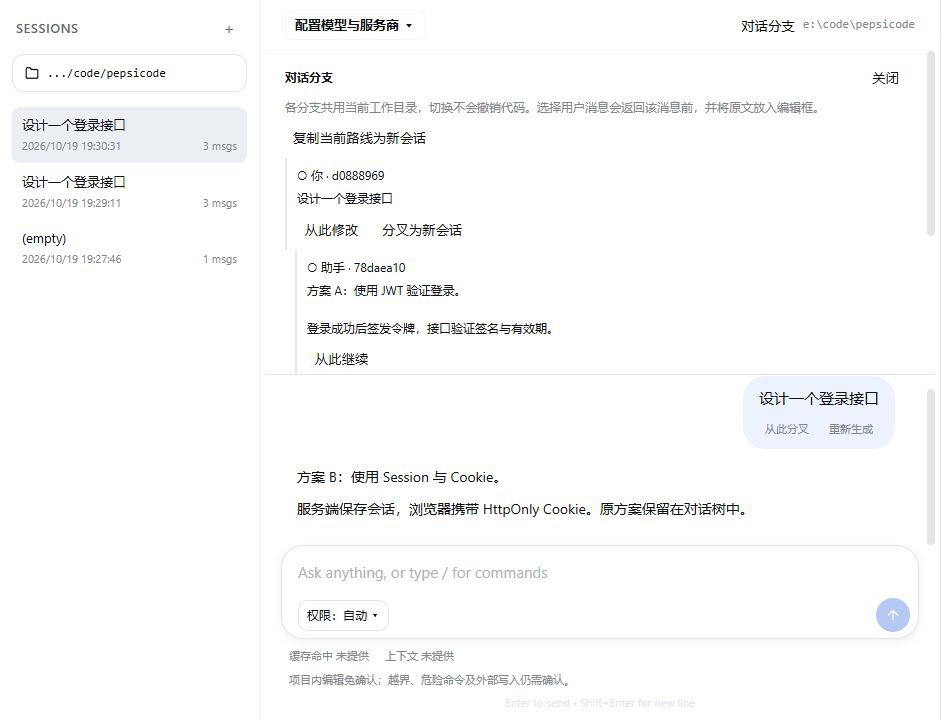

<div align="center">

# pepsicode

**把「想清楚 → 改完 → 验证通过」走完一遍的本地编程代理**

终端全屏 TUI 与 Electron 桌面客户端共用同一套代理内核：权限感知的工具、只读 Plan 模式、可审计的 Hooks v2、上下文压缩、MCP / Skills / 子代理，以及修改后的自动验证与修复。


[](LICENSE)
[](#模型配置)
[](#内置工具)
[](https://github.com/peps1666/pepsicode/actions/workflows/ci.yml)

[功能一览](#功能一览) · [快速开始](#快速开始) · [桌面客户端](#electron-桌面客户端) · [内置工具](#内置工具) · [Hooks v2](#hooks-v2) · [模型配置](#模型配置) · [开发与验证](#开发与验证)

</div>

<p align="center">
  
  <br>
  <sub>终端界面：一次修改从定位、打补丁，到自动验证并交付的完整链路</sub>
</p>

> **English summary** — pepsicode is a Python coding agent for local development workflows, usable from a full-screen terminal UI or an Electron desktop client. It ships 38 built-in tools, LSP-backed code intelligence, an automatic verify-and-fix loop, permission modes with a read-only Plan mode, project-trusted Hooks v2, MCP / Skills / sub-agents, context compaction, multi-provider model switching, and a token-authenticated WebSocket server.

<details>
<summary><b>目录</b></summary>

- [这是什么](#这是什么)
- [功能一览](#功能一览)
  - [交互与协作](#交互与协作) · [代码理解与修改](#代码理解与修改) · [质量闭环](#质量闭环)
  - [扩展与自动化](#扩展与自动化) · [安全与治理](#安全与治理) · [上下文与可观测](#上下文与可观测)
- [快速开始](#快速开始)
- [Electron 桌面客户端](#electron-桌面客户端)
- [内置工具](#内置工具)
- [子代理与后台任务](#子代理与后台任务)
- [记忆系统](#记忆系统)
- [运行中补充指令与任务排队](#运行中补充指令与任务排队)
- [对话分支与重新生成](#对话分支与重新生成)
- [Plan 模式](#plan-模式)
- [权限模式](#权限模式)
- [Hooks v2](#hooks-v2)
- [Markdown 自定义命令](#markdown-自定义命令)
- [Skills 与 MCP](#skills-与-mcp)
- [上下文管理](#上下文管理)
- [模型配置](#模型配置)
- [常用命令](#常用命令)
- [设计取舍](#设计取舍)
- [开发与验证](#开发与验证)
- [安全说明](#安全说明)
- [License](#license)

</details>

---

## 这是什么

pepsicode 是一个面向本地开发工作流的 Python 编程代理。它有两种前端、一个内核：既能作为终端里的全屏交互程序使用，也能作为白色主题的桌面应用启动，两者共享同一套工具、权限、Hook 与上下文机制。

它和「只会补全代码」的助手不同的地方在于**闭环**：修改文件后会按项目约定跑检查，把失败输出送回模型继续修，修不动就停并交还用户；每个动作都在权限模式、Hooks v2 和可选的语言服务约束下执行；一次会话可以直接切分支重试另一套方案，而原始路线仍然留在历史里。

第二版在原有工具、MCP、Skills、子代理、Plan 模式和上下文压缩之上，新增了可配置、可审计且受权限系统约束的 **Hooks v2**，以及基于 WebSocket 的 **桌面客户端架构**。

一轮任务的基本形状：

| 阶段 | 做什么 | 把关点 |
| --- | --- | --- |
| **① 规划**（可选） | 进入 Plan 模式只读调研，写出计划等你批准 | 只读边界 · 计划审批 |
| **② 执行** | 按计划调工具改文件、跑命令 | 权限模式 · Hooks v2 |
| **③ 验证** | 按项目约定跑 tests / lint / build | 无测试、被拒绝都不算通过 |
| **④ 交付或继续修** | 通过则汇总交付；失败把输出送回模型继续修，超过阈值就停 | 无进展断路保护 |

## 功能一览

### 交互与协作

| 能力 | 说明 |
| --- | --- |
| 全屏 TUI | 只刷新变化的行，用 DEC 2026 同步输出整帧提交，流式刷新最多每秒 30 次；权限确认在输入区原位显示，不整屏切换 |
| 桌面客户端 | React + Vite 白色主题，WebSocket + JSON-RPC 信封，流式事件与权限审批弹窗；主进程自动拉起 Python 服务端 |
| 运行中补充指令 | 任务不停也能继续输入：补充当前任务、排到完成后执行、随时取回，队列最多 32 条 |
| 对话分支 | 树形历史保存多条路线，`/tree` 切换、`/fork` 分叉为独立会话、`/clone` 复制、`/retry` 新分支重跑 |
| Markdown 自定义命令 | 把 `.md` 放进 `.pepsi-code/commands/` 就是一条命令，支持位置参数与默认值，排在队列里也生效 |

### 代码理解与修改

| 能力 | 说明 |
| --- | --- |
| 按需语义导航 | 文件符号、定义跳转、引用、诊断与只读重命名预览；按需启动 basedpyright / pyright / pylsp、typescript-language-server、gopls、rust-analyzer，缺服务时明确标记 fallback |
| 跨文件重命名 | `rename_symbol` 逐文件经过路径与编辑审批，不套用 Python 标识符规则，由对应语言服务校验 |
| 编辑工具族 | 整文件写入、子串替换、多处精确替换、整文件覆盖、批量多文件编辑、Jupyter Notebook 单元格编辑，改动前先给 diff |
| 搜索与浏览 | 正则内容搜索、目录列举、带图标的文件树、有界读取，超大输出转为 artifact 后按 ID 分块读回 |
| 按需加载工具 | 首个请求只发送核心工具定义，模型用 `search_tools` 搜索后再注入，减少每次请求的 schema 体积 |

### 质量闭环

| 能力 | 说明 |
| --- | --- |
| 自动验证与修复 | `verificationMode: auto/always/off`；按真实测试文件与 `package.json` 脚本发现检查，失败进上下文、修复后重跑，无进展达上限即停 |
| 验证报告可追溯 | 终端显示进度，桌面显示可展开报告；无测试、被审批或 Hook 拒绝、未执行都不会被算作「通过」 |
| 测试与调试 | `test_runner` 支持 pytest / unittest 与覆盖率，`run_with_debug` 解析 Python traceback 与 Node 堆栈并回传结构化错误位置 |
| 代码审查与差异 | `code_review` 检查未用导入、硬编码、缺失文档与超长函数；`diff_viewer` 提供 unified / inline / stats 三种对比 |

### 扩展与自动化

| 能力 | 说明 |
| --- | --- |
| Hooks v2 | 12 类生命周期事件 × 4 种安全动作（`deny` / `notify` / `context` / `command`），关键前置 Hook 同步确定性阻断 |
| 项目信任 | 项目级 Hook 默认禁用，按路径与文件内容 SHA-256 指纹授权，配置一改就重新确认 |
| MCP | 本地 stdio 与远程 Streamable HTTP；可逐工具声明 `readOnlyTools`，未声明只读的工具按需审批 |
| Skills | `SKILL.md` 按需加载的领域说明；内置演示 Skill 走本地 MCP 取仓库元数据 |
| 子代理 | `explore` / `plan` / `general` / `verification` 四类，各自独立上下文窗口，只回传摘要 |

### 安全与治理

| 能力 | 说明 |
| --- | --- |
| 三档权限模式 | 只读 / 自动（新会话默认）/ 完全访问；模式随会话保存并在恢复时还原 |
| Plan 只读边界 | 只允许只读工具与计划文件写入；Hook 的 `command` 动作在 Plan 中无条件禁用，无法借 Hook 绕过 |
| 命令分类沙箱 | 命令按分类走审批，Python / Shell 等任意代码执行仍逐次确认 |
| 连接认证 | 建会话前必须令牌认证并校验 Origin；令牌只走受限 IPC，不进 URL 或日志 |
| 启动变量隔离 | 子进程继承厂商 Key 与模型设置，同时移除 Electron / Chromium 的运行时注入变量 |

### 上下文与可观测

| 能力 | 说明 |
| --- | --- |
| 常驻用量显示 | 输入区下方常驻「缓存命中率」与「上下文窗口占比」，随流式用量即时刷新 |
| 分层上下文控制 | 大结果头尾保留 → 大输出 artifact 化 → 接近上限自动压缩 → 溢出强制压缩并有限重试 |
| 成本与状态 | `/cost`、`/cost-report`、`/context`、`/status`、`/tasks` 随时查 |
| 会话持久化 | 自动保存最新消息与终端记录（含未完成输出），`/resume` 按项目列出并恢复 |
| 持久记忆 | `save_memory` / `search_memory` / `forget_memory`，分 `user` / `project` / `local` 三种作用域 |

> 语义导航、自动验证与工具按需加载的完整配置项见[代码理解与执行闭环](docs/agent-capabilities.md)。

## 快速开始

### 环境要求

- Python 3.11+
- Windows、macOS 或 Linux
- 一个 Anthropic 兼容接口；也可以使用内置 mock 模型进行本地验证

### 安装与启动

```bash
git clone https://github.com/peps1666/pepsicode.git
cd pepsicode
python -m pip install -e ".[dev]"
python -m pepsicode.main --install
```

安装后可以直接运行：

```bash
pepsicode
```

也可以不安装命令入口：

```bash
python -m pepsicode.main
```

使用 mock 模型启动：

```powershell
$env:PEPSI_CODE_MODEL_MODE = "mock"
python -m pepsicode.main
```

```bash
PEPSI_CODE_MODEL_MODE=mock python -m pepsicode.main
```

检查配置是否正确：

```bash
python -m pepsicode.main --validate-config
```

## Electron 桌面客户端

pepsicode 提供一个独立的 Electron 桌面应用，采用白色主题界面，体验类似 Codex / Claude Desktop，可以在图形界面里选择项目文件夹并与代理对话。

<p align="center">
  
  <br>
  <sub>桌面客户端：左侧会话列表，中间对话分支（同一需求的两种方案并存），底部权限模式选择</sub>
</p>

### 架构

| 位置 | 组件 | 职责 |
| --- | --- | --- |
| 前端 | **Electron 桌面客户端**（React + Vite） | 白色主题 UI、项目文件夹选择、会话列表、流式消息、权限审批弹窗 |
| 通道 | **WebSocket · JSON-RPC**（`ws://127.0.0.1:<port>`） | 客户端发请求，服务端回流式事件与权限请求；建会话前必须令牌认证 |
| 后端 | **Python 服务端**（`pepsicode.server`） | Agent Loop、工具 / Skills / MCP、权限模式与 Hooks v2、上下文管理 |

Electron 主进程在启动时自动拉起 Python WebSocket 服务端，前端通过 `ws://127.0.0.1:<port>` 连接后端，使用 JSON-RPC 信封通信，支持流式事件（`message/delta`、`tool/call`、`tool/result` 等）和权限请求。

连接在创建会话前必须完成令牌认证，并校验 WebSocket Origin。Electron 自动生成本次启动专用的随机令牌，通过受限 IPC 交给主窗口，不放进 URL 或日志。Python 子进程继承用户的厂商 Key、模型设置和自定义环境变量，同时移除 Electron/Chromium 的运行时注入变量；可用 `PEPSI_PYTHON` 指定 Python 路径，也可使用当前 PATH 中的 Python。

独立启动服务端时，先设置 `PEPSI_CODE_SERVER_TOKEN`，例如在 PowerShell 中：

```powershell
$env:PEPSI_CODE_SERVER_TOKEN = python -c "import secrets; print(secrets.token_urlsafe(32))"
python -m pepsicode.server --port 8765
```

自定义客户端连接后的第一帧必须为 `{"kind":"request","id":0,"method":"connection/auth","params":{"token":"本次配置的令牌"}}`；收到 `authenticated: true` 后再发送业务请求。默认接受无 Origin 的本机客户端，以及 Origin 为 `null` 或 `file://` 的桌面文件页面，均必须认证。浏览器开发页面须通过 `PEPSI_CODE_SERVER_ORIGINS` 显式配置允许的 Origin（JSON 字符串数组，不接受 `*`）；Electron 开发模式会自动配置其开发地址。

### 环境要求

- Node.js 18+
- Python 3.11+（同 CLI 要求）
- 已安装 pepsicode 包（`pip install -e .`）

### 构建与启动

```bash
cd pepsicode-client
npm install
npm run build      # 构建前端 (dist/) 和 Electron 主进程 (dist-electron/)
npm start          # 启动桌面应用
```

开发模式（热重载）：

```bash
# 终端 1：启动 Vite dev server
PEPSI_DEV_SERVER=1 npm run dev

# 终端 2：启动 Electron（连热重载）
npm start
```

### 选择项目文件夹

侧边栏按「项目 → 对话」组织。点击「项目」右侧的 `+` 选择文件夹，添加的项目及展开状态会在本机保留；同一目录不会重复添加。每个项目旁的新建按钮用于在该目录中开启独立对话，顶部「新建对话」则使用当前项目。

点击项目可展开或折叠它的对话列表，点击对话会恢复历史，并把工具执行、文件读写、命令运行的 cwd 切换到所属项目。已有对话继续按项目保存，任务运行期间不能切换项目或对话。

### 模型配置

桌面客户端共用同一套配置文件（`~/.pepsi-code/settings.json`），模型和 API Key 的读取优先级与 CLI 一致（见下方[模型配置](#模型配置)章节）。

输入框底部左侧显示当前模型与思考深度。点击可从当前 API 返回的模型列表中选择，显示名称与请求 ID 分别读取；思考档位来自接口的能力元数据。可点击「刷新模型列表」重新读取。点击「应用」后从下一轮生效，保留聊天记录与费用统计；当前轮执行期间禁止切换。

默认只修改当前会话，设置随下一轮对话一同自动保存，恢复会话时会恢复服务商、模型与思考深度。勾选「同时保存为新会话默认设置」会写入 `~/.pepsi-code/settings.json`；环境变量依然具有更高优先级。在 `providers` 中配置四家的独立凭据后，可在同一对话中切换服务商。Mock 模式下该入口禁用。

### 打包为 Windows ZIP 便携版

```bash
cd pepsicode-client
npm ci
npm run release:zip
# 兼容入口：npm run electron:build
```

构建需要 Windows 10/11 x64、Python 3.12 和 Node.js 22+。脚本会在 `build/desktop-venv` 创建隔离构建环境，将 Python 后端、依赖和内置 agent 资源一起打包，使用 Windows 自带的 .NET Framework 编译小型启动器，然后输出 `pepsicode-client/release/Pepsicode-2.0.0-win-x64.zip` 与 `.sha256` 校验文件。ZIP 发布前会检查内部文件 CRC。

使用者完整解压 ZIP 后双击 `Pepsicode.exe` 即可，无需安装 Python、Node；首次打开在界面配置自己的模型服务商和 API Key。项目自身需要的 Git、测试运行时、语言服务器等仍使用该项目的开发环境。配置与会话保存在用户目录，免安装不表示所有数据都保存在解压目录中。初版 ZIP 未签名。

成品验收命令（在仓库根目录运行）：

```powershell
.\build\desktop-venv\Scripts\python.exe scripts/smoke_desktop_zip.py pepsicode-client/release/Pepsicode-2.0.0-win-x64.zip
cd pepsicode-client
npm run release:smoke
```

这两项验收分别检查真实后端协议、真实桌面窗口及退出清理，均在中文和空格目录中解压运行，隔离用户数据，并从 PATH 移除 Python / Node。[TDD 实施与验收记录](docs/windows-zip-tdd.md)列出了每一步的任务、注意事项和验证边界。GitHub Actions 的 `Windows ZIP` 工作流可手动生成并上传构建 artifact；不会自动发布 GitHub Release。

## 内置工具

默认注册 **38 个内置工具**，MCP 服务器可再动态注入。首轮只发送核心工具，其余通过 `search_tools` 按任务、关键词或准确名称（`query` 传 `*` 可浏览全部并按 `offset` 翻页）加载。

| 分类 | 工具 |
| --- | --- |
| 文件与代码 | `read_file`、`write_file`、`edit_file`、`modify_file`、`patch_file`、`multi_edit`、`notebook_edit`、`read_context_artifact` |
| 搜索与浏览 | `grep_files`、`list_files`、`file_tree` |
| 代码智能 | `code_intelligence`、`find_symbols`、`find_references`、`get_ast_info`、`rename_symbol`、`code_review` |
| 执行与验证 | `run_command`、`run_with_debug`、`test_runner`、`governance_audit` |
| 协作与规划 | `task`、`todo_write`、`ask_user`、`exit_plan_mode`、`search_tools`、`load_skill` |
| 外部信息 | `web_search`、`web_fetch`、`api_tester` |
| 数据与服务 | `db_explorer`、`docker_helper` |
| 版本控制 | `git`、`worktree`、`diff_viewer` |
| 记忆 | `save_memory`、`search_memory`、`forget_memory` |

写入类工具（`write_file`、`edit_file`、`modify_file`、`patch_file`、`multi_edit`）都会先给出 diff 再落盘，审批规则由当前权限模式决定。可用 `/tools` 查看完整清单，或 `toolCoreTools` 覆盖初始工具名单。

## 子代理与后台任务

`task` 把限定的子任务交给独立上下文窗口的子代理，主代理只收到摘要，因此大规模代码探索不会撑爆主上下文。

| 子代理 | 定位 |
| --- | --- |
| `explore` | 快速只读搜索，定位文件与调用关系 |
| `plan` | 只读但更彻底的调研分析 |
| `general` | 完整的读写与命令执行能力 |
| `verification` | 专门跑构建、测试与 lint 来验证改动 |

子代理与主代理共用同一套 Hook 引擎，各自保留 `scope`（`main` / `subagent`）。运行中的轮次可以随时停止，停止信号会传给模型读取、后续工具与子代理，命令会清理自身子进程。`/tasks` 查看后台任务。

## 记忆系统

`save_memory` 持久化决策、约定、模式与事实，跨会话保留，按作用域分开存放：

| 作用域 | 用途 |
| --- | --- |
| `user` | 跨项目通用偏好 |
| `project` | 可随仓库共享、纳入版本管理 |
| `local` | 本项目专用，不提交 |

传入已有 `id` 会替换该条目而不是追加。`search_memory` 按内容、类别或标签查找不在当前提示词里的条目，`forget_memory` 按作用域与 `id` 删除——不要留下互相矛盾的两条。终端用 `/mem` 或 `/memory` 查看。

## 运行中补充指令与任务排队

任务运行时可以继续输入，不必先停止代理：

| 操作 | 桌面端 | 终端 |
| --- | --- | --- |
| 补充当前任务 | 选择「补充当前任务」并发送 | Enter |
| 完成后执行新任务 | 选择「完成后执行」，或 Alt+Enter | Alt+Enter，或输入 `/queue 任务内容` |
| 取回尚未处理的输入 | 点击队列中的「取回」 | Alt+↑ 取回最后一条 |
| 停止任务 | 点击「停止」 | Ctrl+C |

补充指令在当前模型响应及整批工具执行完成后、下一次模型请求前生效，不会打断已开始的命令。后续任务按提交顺序逐项执行，等待当前任务的自动验证与修复结束；补充指令优先于后续任务。排队本身不改变权限或 Plan 模式。

停止、模型报错、验证失败或受阻、代理等待澄清时，尚未处理的输入退回编辑框，并保留正在编辑的草稿。只有实际进入代理上下文的输入才会加入聊天记录。运行时不能通过队列执行 `/model`、`/permissions` 等本地命令，请在任务结束后操作；下文 Markdown 提示词命令可以排队。队列最多容纳 32 条输入，原始输入最多 32000 字符，Markdown 命令展开后最多 128000 字符，与空闲时调用使用同一展开上限；队列只在当前进程中保留，尚未提供跨进程恢复。

部分 Windows 终端会占用 Alt 快捷键，可使用 `/queue` 和桌面端按钮。

## 对话分支与重新生成

对话以树形历史保存，可以从旧消息继续尝试另一套方案，原路线仍可切回。各分支共用当前工作目录，切换分支不会撤销文件，也不会创建 Git worktree。

| 命令 | 行为 |
| --- | --- |
| `/tree` | 显示当前会话所有路线及消息 ID，`+` 表示当前路线，`*` 表示当前末尾 |
| `/tree <id>` | 切换到所选消息；选用户消息会返回该消息之前，并取出原文作为草稿；选助手回答则从回答之后继续 |
| `/fork` | 列出可作为分叉起点的用户消息 |
| `/fork <用户消息id>` | 新建独立会话，复制起点之前的路线，并取出该用户消息；原会话完整保留 |
| `/clone` | 新建独立会话，复制当前路线全部内容 |
| `/retry` | 在当前会话的新分支重新执行上一条用户消息，保留原回答 |

消息 ID 可以使用唯一前缀。桌面端点击顶部「对话分支」可查看和切换路线；用户消息下方提供「从此分叉」「重新生成」。终端选择用户消息后会把原文放入编辑框；管道 CLI 会输出草稿文本，由下一行输入决定继续内容。

重新生成会再次调用模型，可能再次执行工具和修改文件，沿用当前模型、权限审批和自动验证。Markdown 命令使用原先保存的展开内容。运行中的任务结束后才能切换、分叉或重新生成。

分支历史随会话保存，压缩模型上下文不会删除已经归档的原始消息；切换分支会清空旧路线的压缩摘要。旧版本会话按已保存的内容导入，无法补回升级前已经被压缩删除的消息。文件状态、当前权限和待验证修改不随历史消息回退。

## Plan 模式

输入 `/plan` 或 `/plan <任务>` 后，pepsicode 进入只读规划状态：

- 只允许只读工具、`ask_user`、`exit_plan_mode` 以及 explore/plan 子代理。
- 仅当前 `.pepsi-code/plans/` 中的计划文件允许写入。
- 模型调研并写出计划，用户批准后才退出 Plan 模式。
- Hooks v2 的 `command` 动作无条件禁用。
- `/hooks trust` 等会写入持久状态的入口也会被拒绝。

这意味着 Hook 可以为规划补充提醒或模型上下文，但不能借 Hook 运行命令绕过 Plan 边界。

## 权限模式

点击桌面输入框左下角的「权限」，或输入 `/permissions` 打开三选一菜单，当前模式后显示 `√`。终端中用 ↑/↓ 选择、Enter 应用、Esc 返回，无需填写参数。带参数命令仍保留供脚本使用。

| 模式 | 行为 |
| --- | --- |
| 只读 | 允许文件读取、搜索和声明为只读的工具；拒绝编辑、命令执行及外部写入 |
| 自动（新会话默认） | 项目内编辑和常规命令免确认；项目外路径、危险或未知命令、未声明只读的 MCP 工具按需确认 |
| 完全访问 | 文件访问、编辑、命令及 MCP 工具均免权限确认 |

模式随会话保存，恢复会话时恢复选择。Plan 是独立的规划状态，始终保留只读边界和计划审批，退出后回到所选权限模式。完全访问也不会取消 Hook 的拒绝规则。

自动模式是应用层审批策略，当前命令后端没有操作系统级沙箱；运行的程序仍具有当前系统用户的权限。Python、Shell 等任意代码执行命令仍按现有规则确认。

## Hooks v2

### 配置层级

按以下顺序加载，同 ID 的可信后层配置覆盖前层配置：

1. `~/.pepsi-code/hooks.json`：用户级，自动视为可信。
2. `<workspace>/.pepsi-code/hooks.json`：项目级，适合提交到仓库。
3. `<workspace>/.pepsi-code/hooks.local.json`：本机覆盖，默认已加入 `.gitignore`。

项目级和本机 Hook 默认不执行。首次发现时，交互模式会提供“信任当前版本”“仅本次信任”“保持禁用”三个选择；非交互模式保持禁用。永久信任记录绑定到路径和文件内容 SHA-256 指纹，配置一旦变化就必须重新确认。

### 最小配置

```json
{
  "version": 1,
  "hooks": [
    {
      "id": "protect-secrets",
      "event": "pre_tool_use",
      "priority": 10,
      "when": {
        "tool": ["write_file", "edit_file", "patch_file"],
        "args.path": {"regex": "(^|[/\\\\])\\.env($|[/\\\\])"}
      },
      "action": {
        "type": "deny",
        "message": "拒绝修改受保护的环境配置：{path}"
      }
    },
    {
      "id": "review-after-tests",
      "event": "post_tool_use",
      "when": {
        "tool": "run_command",
        "args.command": {"contains": "pytest"}
      },
      "action": {
        "type": "context",
        "message": "测试命令已结束。检查失败原因和回归风险后再继续。"
      }
    },
    {
      "id": "notify-session-save",
      "event": "session_save",
      "action": {
        "type": "notify",
        "message": "会话 {session_id} 已保存"
      }
    }
  ]
}
```

配置根节点也可直接写成 Hook 数组。设置 `"strict": true` 后，只要同一文件存在一条无效配置，整份文件都不会加载。

### 支持的事件

| 事件 | 触发时机 |
| --- | --- |
| `pre_tool_use` | 工具校验后、权限检查和实际执行前 |
| `post_tool_use` | 工具执行完成后 |
| `agent_start` / `agent_stop` | 主代理回合开始和结束 |
| `subagent_start` / `subagent_stop` | 子代理开始和结束 |
| `user_input` | 收到用户输入 |
| `assistant_output` | 代理产出最终回复 |
| `context_compact` | 自动或溢出恢复压缩完成 |
| `session_save` / `session_resume` | 会话保存和恢复 |
| `startup` / `shutdown` | 应用启动和关闭 |
| `error` | 工具或模型流程发生错误 |

### 动作

`deny`

- 仅允许用于 `pre_tool_use`。
- 在权限检查和工具执行前同步阻断，并向模型返回明确错误。

`notify`

- 向 CLI/TTY 输出通知，不修改模型上下文。

`context`

- 将受长度限制的 `<hook-context>` 块加入下一次模型调用。
- 注入内容不会追加到会话消息，因此不会在多轮中重复积累。

`command`

- 使用 argv 数组，不通过字符串 shell 拼接。
- 复用 `run_command` 的目录边界、命令分类和权限审批。
- 不能用于 `pre_tool_use`，Plan 模式中始终禁用。
- 支持 `timeoutSeconds`、`background` 和 `exposeOutputToModel`。
- 大输出会写入 `.pepsi-code/tool-results/`，模型和 UI 只接收有界预览。

示例：

```json
{
  "id": "format-after-write",
  "event": "post_tool_use",
  "scope": ["main"],
  "when": {
    "tool": ["write_file", "edit_file", "patch_file"],
    "args.path": {"glob": "*.py"}
  },
  "action": {
    "type": "command",
    "argv": ["python", "-m", "ruff", "format", "{path}"],
    "timeoutSeconds": 30,
    "exposeOutputToModel": true
  }
}
```

命令是否获准仍由当前 PermissionManager 决定。Hook 配置本身不能声明“免审批”。

### 条件与模板

`when` 支持以下结构化操作符：

- 直接值：`eq`
- 数组：`in`
- `{ "contains": "..." }`
- `{ "glob": "..." }`
- `{ "regex": "..." }`

常用字段包括 `event`、`tool`、`path`、`args.<name>`、`result.<name>`、`permission_mode`、`agent_scope` 和错误字段。正则表达式和参与匹配的值都有长度限制，避免配置造成无界处理。

消息与 argv 支持 `{event}`、`{tool}`、`{path}`、`{cwd}`、`{permission_mode}`、`{agent_scope}`、`{error}` 和 `{args.<name>}` 替换。

### Scope、顺序与一次性执行

- `scope` 可为 `main`、`subagent` 或两者数组，默认两者都执行。
- `priority` 越小越先执行，默认 `100`。
- `once: true` 在单进程中最多执行一次；并行工具调用下也使用原子 claim。
- `background: true` 只适用于非前置动作，后台任务由受管线程池执行。
- Hook 失败不会让代理循环崩溃；`onError` 可设为 `ignore`、`warn`，前置 Hook 还可用 `deny`。

### 管理命令

```text
/hooks
/hooks list
/hooks errors
/hooks reload
/hooks trust
/hooks enable <id>
/hooks disable <id>
```

`/hooks enable` 和 `/hooks disable` 只影响当前进程。`/hooks trust` 会为当前项目 Hook 文件保存内容指纹，并重新加载配置。

### Python 兼容 API

旧版程序化事件 API 保持可用：

```python
from pepsicode.hooks import HookEvent, register_hook

unregister = register_hook(
    HookEvent.POST_TOOL_USE,
    lambda context: print(context.tool_name),
    "audit tool usage",
)
```

`HookManager`、`register_hook`、`fire_hook`、`fire_hook_sync`、`create_logging_hook` 和 `create_script_hook` 均保留。配置驱动的新 Hook 建议优先使用 `hooks.json`，因为它具备验证、信任和权限治理。

## Markdown 自定义命令

将 Markdown 文件放到当前项目的 `.pepsi-code/commands/`，或个人目录 `~/.pepsi-code/commands/`，文件名就是命令名。同名时项目版本优先；内置命令和 `/queue` 为保留名称，不能覆盖。第一版只读取目录中的直接 `.md` 文件，名称使用 1–64 个英文字母、数字、下划线或连字符，首字符必须是字母或数字。

本仓库已提供 `/review` 和 `/fix-test` 两个项目命令。也可以创建 `.pepsi-code/commands/explain.md`：

```markdown
---
description: 解释模块设计和调用关系
argument-hint: "[文件路径] [关注点]"
---
解释 ${1:-当前项目} 的设计和调用关系。
重点关注 ${2:-模块职责与数据流}，给出具体代码位置。
```

调用示例：`/explain "src/main.py" "错误处理"`。在终端或桌面输入 `/` 可浏览命令；Tab 补全命令名，参数提示不会作为文字插入。桌面支持上下键选择、鼠标点击和刷新列表。输入 `/commands` 查看来源和加载错误，`/commands reload` 强制重载；菜单会短暂缓存，提交命令时始终重新读取文件，因此修改模板无需重启。

| 写法 | 展开结果 |
| --- | --- |
| `$1`、`$2`… | 对应位置参数，缺失时为空 |
| `$ARGUMENTS` 或 `$@` | 所有参数，用空格连接 |
| `${1:-默认值}`、`${@:-默认值}` | 参数缺失或为空时使用默认值 |
| `$$` | 字面量 `$`，例如 `$$1` 得到 `$1` |

单引号和双引号可组合带空格的参数，反斜杠按字面量保留，适合 Windows 路径；引号不闭合会报错。参数只替换一次，不展开环境变量、shell 命令或嵌套表达式。仅解析 `description` 和 `argument-hint` 两个元数据字段；`allowed-tools` 等字段不会授予权限。模板展开为普通用户消息，不改变系统提示词、权限模式或工具审批。

自定义命令可以作为补充指令或后续任务排队。加入队列时固定展开内容；之后修改模板不会改变已经排队的任务。聊天记录显示原始调用，持久会话同时保存展开内容和模板路径；取回或停止时退回原始命令，方便修改参数。

空模板、无效编码、保留名称和路径越界会显示加载错误；项目版本损坏时不会静默退回同名个人版本。每个模板最多 64 KiB，每次最多扫描 256 个文件，参数最多 32000 字符，展开结果最多 128000 字符；排队输入还受队列的 32000 字符限制。

## Skills 与 MCP

仓库内置了一个可以直接验证扩展链路的示例：

- `.pepsi-code/skills/pepsicode-project-health/SKILL.md`：项目健康检查 Skill。
- `examples/mcp/workspace_inspector_server.py`：零外部依赖、只读的 stdio MCP 服务。
- `.mcp.json` 中的 `workspace-inspector`：项目级 MCP 连接配置。
- `.mcp.json` 中的 `sequential-thinking`：本地 stdio 思考链服务。
- `.mcp.json` 中的 `openai-developer-docs`：OpenAI 官方公开、只读的远程 Streamable HTTP MCP。

启动 Pepsicode 后运行 `/skills` 和 `/mcp` 应看到 `pepsicode-project-health`、本地 `workspace-inspector` 和远程 `openai-developer-docs`。在对话中要求“使用 pepsicode-project-health 检查项目”，Skill 会优先调用本地 MCP 的 `project_info` 工具获取仓库元数据；询问 OpenAI API、Codex 或插件问题时，可以调用远程文档 MCP 搜索官方资料。

`.mcp.json` 支持为每个服务器声明 `readOnlyTools`（数组或 `"*"`）：声明的工具在自动模式下免确认，未声明的按需审批。

也可以不启动模型，直接运行定向集成测试：

```bash
python -m pytest -q tests/test_project_extensions.py
```

## 上下文管理

终端输入区和桌面输入框下方常驻显示「缓存命中率」与「当前上下文窗口占比」，收到流式 `message_start` / `message_delta` 的用量数据时立即更新；工具调用之间也会刷新，无需手动输入 `/context`。

缓存命中率按最近一次模型请求的缓存读取 token ÷ 总输入 token 计算（总输入包含普通输入、缓存创建和缓存读取，不包含输出）。支持 Anthropic 缓存字段及兼容接口返回的缓存命中字段；接口未返回缓存统计时显示「未提供」，明确返回零命中时才显示 `0%`。上下文占比包含缓存输入，容量优先使用接口或本地模型配置的 `contextWindow`；使用默认容量或估算 token 数时标注「约」。桌面端悬停可查看 token 数和容量。

pepsicode 使用分层上下文控制：

1. 对较旧的大型工具结果保留头尾并截断中间部分。
2. 大工具输出持久化为上下文 artifact，只把有界预览传给模型。
3. 接近模型上下文上限时自动压缩旧消息。
4. API 返回上下文溢出时强制压缩并有限重试，压缩无进展时触发断路保护。

Hooks v2 的 `context` 动作沿用同样的有界原则：单条和单批注入都有上限，且只存活到下一次模型调用。

## 模型配置

当前提供 **DeepSeek（默认）、Kimi、GLM（智谱）、千问（百炼）** 四家预设，以及一个可命名的 **自定义厂商** 配置。各家分别使用独立的 API Key。终端与桌面端共用 `~/.pepsi-code/settings.json`，可参考仓库的 [`settings.providers.example.json`](settings.providers.example.json)：

终端输入 **`/provider`** 会列出全部四家预设（未配置 Key 的也会显示），默认选中 DeepSeek；选择尚未配置的预设（或直接输入 `/provider deepseek` 等）会打开该厂商的引导，地址已预填，从 API Key 开始填写。没有指定 `provider` 时，已配置的 DeepSeek 优先作为新会话服务商。

无需手写配置即可添加自定义厂商：终端输入 **`/provider add`**，或在 `/provider` 菜单中选择「+ 自定义厂商」；桌面端点击顶部模型按钮，再点「+ 添加自定义厂商」。尚未配置 API 时也能打开引导。当前接口格式为 **Anthropic Messages 兼容**，引导依次填写厂商名称、API Base URL、鉴权方式、API Key、可选的模型列表地址，然后选择模型、检查摘要并确认「保存并使用」。

鉴权支持 `Authorization: Bearer` 和 `x-api-key` 两种方式，Key 输入遮罩且不写入聊天记录或终端输入历史。模型列表直接从接口读取；未提供列表时，可明确选择手动填写服务商给出的模型 ID，并标注未验证可用性。确认前取消不会写入配置或修改当前服务商。终端用 Enter 前进、Alt+← 返回、Esc 取消；模型列表地址步骤可按 Tab 切换「无列表」。最后确认会将凭据写入本机 `~/.pepsi-code/settings.json`，立即启用并设为新会话默认；已有自定义厂商会被更新，其他厂商配置保留。

```json
{
  "provider": "deepseek",
  "providers": {
    "kimi": { "apiKeyEnv": "MOONSHOT_API_KEY" },
    "glm": { "apiKeyEnv": "ZHIPU_API_KEY" },
    "deepseek": { "apiKeyEnv": "DEEPSEEK_API_KEY" },
    "qwen": { "apiKeyEnv": "DASHSCOPE_API_KEY", "modelsUrl": false, "models": [] }
  }
}
```

在 PowerShell 中设置各家的凭据后启动：

```powershell
$env:MOONSHOT_API_KEY = "你的 Kimi Key"
$env:ZHIPU_API_KEY = "你的智谱 Key"
$env:DEEPSEEK_API_KEY = "你的 DeepSeek Key"
$env:DASHSCOPE_API_KEY = "你的百炼 Key"
pepsicode
```

也可在各家配置对象中使用 `apiKey` 或 `authToken`。未配置 Key 的服务商不能切换，不会借用其他家的凭据。`provider` 决定新会话启动的服务商，`PEPSI_CODE_PROVIDER` 可覆盖它。启用 `providers` 后不再继承 `~/.claude/settings.json` 中的模型与思考设置；每家可配置自己的 `model`、`models`、`modelsUrl`、`reasoningEffort`、`maxOutputTokens` 和 `fallbackModel`。

| 服务商 ID | 默认 Messages API Base URL | 接入说明 |
| --- | --- | --- |
| `kimi` | `https://api.moonshot.cn/anthropic` | [官方 Messages API](https://platform.kimi.com/docs/api/messages)；模型目录可设为同源 `/v1/models` |
| `glm` | `https://open.bigmodel.cn/api/anthropic` | [官方接入说明](https://github.com/MetaGLM/glm-cc/blob/main/glm-4.5-claude-code-integration.md)；套餐与标准 API 的目录权限以账号为准 |
| `deepseek` | `https://api.deepseek.com/anthropic` | [官方兼容接口](https://api-docs.deepseek.com/guides/anthropic_api/)；模型目录支持名称、ID、思考档位元数据 |
| `qwen` | `https://dashscope.aliyuncs.com/apps/anthropic` | [百炼接口说明](https://help.aliyun.com/zh/model-studio/anthropic-api-messages)；可覆盖为业务空间专属 Base URL |

**模型列表与思考档位不写死。** `/provider` 打开服务商菜单，再选择该服务商的模型，确认前不会修改当前服务商；Esc 可取消。桌面端点击顶部模型按钮后选择服务商和模型，再应用。切换会同步替换地址、凭据、模型目录和思考设置；会话保存服务商 ID、模型 ID 与档位，恢复时从本地配置重新取 Key。已有聊天记录保留，旧服务商的思考签名会清除。

各家的目录接口并不一致：百炼 Anthropic 兼容端点明确不提供 `/models`，示例因此用 `modelsUrl: false` 关闭探测，需将官方控制台确认的模型 ID 填入 `providers.qwen.models`。若账号提供同源目录地址，也可设置 `modelsUrl` 自动读取。Kimi 的模型目录返回能力标记和上下文长度，但未声明的思考档位不会自动补全；可按官方参数文档在对应 `models` 项中显式声明能力。`output_effort` 模式只发送 `output_config.effort`，适合不接受 `thinking` 开关的兼容端点。声明与版本相关的能力时应使用准确的模型 ID，不做名称前缀匹配。

下面的单接口配置仍可使用，用户配置文件位于 `~/.pepsi-code/settings.json`：

```json
{
  "model": "your-provider-model-id",
  "reasoningEffort": "default",
  "env": {
    "ANTHROPIC_BASE_URL": "https://your-provider.example/anthropic",
    "ANTHROPIC_API_KEY": "your-api-key"
  }
}
```

启动时使用当前 API 地址与凭据读取模型列表，菜单显示接口返回的 `name` / `display_name`，请求使用对应的 `id`，不内置模型候选名称。列表接口通常为 `/v1/models` 或 `/models`，会保留兼容网关的路径前缀并读取分页；若网关采用其他路径，可在配置中设置同源的 `modelsUrl`。列表缓存五分钟，终端可用 `/model refresh` 或菜单中的 `r` 强制刷新。

`reasoningEffort` 默认为 `default`，不额外发送思考参数。其余档位读取接口返回的 `effort.supported_levels` 或 `capabilities.effort`，保留服务端新增的档位；只有接口明确声明支持时才显示「关闭思考」。接口未提供能力元数据时只显示默认档位，不根据模型名称推测。

读取失败时显示具体状态并保留上次成功的列表；首次读取失败则仅显示本地配置，并标记未验证可用性。对于未提供能力元数据的网关，可按其文档显式配置 `models`，作为缺失元数据的补充：

```json
{
  "model": "my-model-alias",
  "reasoningEffort": "high",
  "models": [
    {
      "id": "my-model-alias",
      "reasoningMode": "effort",
      "reasoningLevels": ["low", "high", "max"],
      "supportsThinkingOff": true
    }
  ]
}
```

`reasoningMode` 可设为 `none`（默认参数）、`budget`（`thinking.budget_tokens`）、`budget_effort`（预算与 `output_config.effort`）、`adaptive`（自适应 `thinking` + `output_config.effort`）、`output_effort`（只发送 `output_config.effort`）或 `effort`（启用 `thinking` + `output_config.effort`）。显式使用 `budget` 模式时，客户端的 `low/medium/high` 预算分别为 1024/4096/16384；`maxOutputTokens` 必须大于预算，未配置时预留 4096 token 用于回答。能力声明应与服务端实际支持保持一致，参考 [DeepSeek 参数说明](https://api-docs.deepseek.com/guides/anthropic_api/) 和 [Kimi 参数参考](https://platform.kimi.com/docs/api/messages)。默认请求显式发送 `max_tokens`，未配置输出上限时使用客户端的 4096 token 默认值（不会超过接口声明的上限）。

也可使用环境变量：

| 变量 | 说明 |
| --- | --- |
| `PEPSI_CODE_MODEL` | 模型名称（最高优先级，覆盖配置文件） |
| `PEPSI_CODE_PROVIDER` | 新会话服务商：`kimi`、`glm`、`deepseek`、`qwen`、`custom` |
| `PEPSI_CODE_REASONING_EFFORT` | 思考深度，覆盖配置文件的 `reasoningEffort`；交互切换可覆盖当前会话 |
| `ANTHROPIC_MODEL` | 模型名称（被 `PEPSI_CODE_MODEL` 和 `settings.json` 覆盖） |
| `ANTHROPIC_API_KEY` | API Key |
| `ANTHROPIC_AUTH_TOKEN` | 可替代 API Key 的认证令牌 |
| `ANTHROPIC_BASE_URL` | Anthropic 兼容接口地址 |
| `PEPSI_CODE_MODEL_MODE=mock` | 使用 mock 模型 |
| `PEPSI_CODE_MOUSE=0` | 关闭鼠标捕获，改用终端原生选择；默认开启，支持滚轮翻看历史和应用内拖选复制 |
| `PEPSI_CODE_HOOKS=0` | 完全关闭 Hooks v2，不加载配置也不提示信任 |
| `NO_COLOR=1` | 关闭终端配色，保留交互光标和文字强调 |

终端界面使用统一的暖色强调、紧凑启动页和固定位置的输入区。命令菜单会按窗口高度缩短，并保持当前选中项可见；中文和长路径按实际显示宽度换行。输出重定向到文件或 `TERM=dumb` 时自动使用无样式文本。

交互界面只刷新发生变化的行，并用同步输出（DEC 2026）一次性提交整帧，流式刷新最多每秒 30 次；工具结果直接以折叠状态出现，权限确认在输入区原位显示，不会整屏切换。长输入会随光标横向滚动；窗口调整大小后会重新排版，并预留最右侧一列以避免终端自动折行造成页面跳动。

终端默认捕获鼠标：滚轮或 `PageUp` / `PageDown` 翻看聊天记录，翻到上方时新输出不会把视图拉回底部。用鼠标左键拖选文字，松开后自动复制到剪贴板（Windows 原生剪贴板、`pbcopy`、`wl-copy`/`xclip`/`xsel`，都不可用时使用 OSC 52）；选中状态下连续按 `Ctrl+C` 都只复制并保留选区，按任意其他键取消选中。没有可识别选区时，第一次 `Ctrl+C` 只显示提示，需在两秒内再次按下才退出；也可以输入 `/exit` 后按 Enter 退出。如果更想用终端原生选择，大多数终端（包括 Windows Terminal）可按住 `Shift` 拖选（参见 [文字选择](https://learn.microsoft.com/en-us/windows/terminal/selection)），或在启动前设置 `PEPSI_CODE_MOUSE=0` 完全关闭鼠标捕获。Windows 交互期间关闭控制台对 `Ctrl+C` 的系统中断处理，退出后恢复原始输入模式。

任务运行时，没有选区的 `Ctrl+C` 会停止当前轮并保留会话界面；空闲时仍需在两秒内连续按两次退出。停止信号会传给模型读取、后续工具和子代理，命令会清理自身的子进程；尚在建立连接、未收到 HTTP 响应头的请求需要等待连接超时或返回后停止。`/cmd` 等工具快捷命令在后台执行，运行时可继续编辑草稿，按 Enter 会保留草稿而不会丢弃。支持括号粘贴的终端会把整段粘贴内容放入输入框，多行文本保留换行，需另按 Enter 发送。`Ctrl+A/E/U` 分别移到行首、行尾、清空输入，`Ctrl+P/N` 浏览输入历史。

自动保存会同步最新消息和终端记录，包括尚未完成的输出。`/resume` 仅列出当前项目的会话；使用 ID 恢复其他项目时会提示先切换到对应目录，再运行 `pepsicode --resume <id>`。

终端交互界面和管道输入都支持在当前进程中切换模型、调整思考深度，无需重启：

在交互终端输入 `/model` 或 `/effort` 并回车，会打开选择菜单。思考强度菜单列出当前模型由接口声明的全部档位，常见档位附中文说明，不需要手动填写参数；`√ 当前` 标记已生效的选项，`>` 表示方向键正在选中的选项。用 ↑/↓ 移动、Enter 应用、Esc 取消，按 `s` 切换是否保存为新会话默认设置，按 `r` 重新读取接口。

如果配置的模型 ID 不在当前接口返回的列表中，交互界面会显示配置来源并打开模型菜单；选择前不发送模型请求。尚未发送的问题会保留在输入框中。下面的带参数命令仍可用于快捷操作和管道输入（模型 ID 与档位以接口返回内容为准）：

```text
/model                         # 查看当前模型与思考深度
/provider                      # 打开服务商菜单，再选择模型
/provider add                  # 逐步配置自定义厂商（交互终端）
/provider glm                  # 打开智谱的模型菜单（交互终端）
/provider kimi <model-id>      # 切换服务商及模型，支持 --save
/model list                    # 查看模型候选
/model refresh                 # 强制从当前 API 重新读取模型列表
/model <provider-model-id>     # 切换当前会话模型
/effort                        # 查看当前深度及该模型允许的档位
/effort max                    # 调整深度，从下一轮生效
/effort off                    # 关闭思考（需模型支持）
/effort default                # 恢复服务端默认行为
/effort high --save            # 同时把当前模型与深度保存为新会话默认设置
/model <provider-model-id> --save # 切换模型并保存默认设置
```

默认只影响当前会话，保留聊天记录；切换到其他模型时将思考深度重置为 `default`，可再用 `/effort` 选择。终端输入区显示当前模型和深度，交互会话在自动保存或退出时保存设置，`--resume` 和 `/resume` 会恢复它们。管道模式的设置仅在当前进程有效，持久化请使用 `--save`。环境变量会在新进程启动时覆盖已保存的默认设置。当前轮执行期间、Mock 模式下不允许切换；Plan 模式可查询设置和候选列表，但禁止修改。

## 常用命令

| 命令 | 用途 |
| --- | --- |
| `/help` | 查看命令帮助 |
| `/model [list\|refresh\|模型 ID] [--save]` | 查看、刷新或切换模型；可选保存默认设置 |
| `/provider [服务商 ID] [模型 ID] [--save]` | 选择服务商与模型；`list` 查看配置状态 |
| `/effort [档位] [--save]` | 查看或调整当前模型的思考深度 |
| `/permissions` | 切换权限模式 |
| `/plan [task]` | 进入只读 Plan 模式 |
| `/hooks` | 查看 Hooks v2 状态、信任、启停 |
| `/tools` | 列出工具 |
| `/skills` | 列出 Skills |
| `/mcp` | 查看 MCP 状态 |
| `/commands` | 查看自定义命令来源与加载错误 |
| `/tree`、`/fork`、`/clone`、`/retry` | 对话分支与重新生成 |
| `/queue [任务]` | 查看队列或排入后续任务 |
| `/context` | 查看上下文占用 |
| `/cost`、`/cost-report` | 查看模型调用成本 |
| `/tasks` | 查看后台任务 |
| `/mem`、`/memory` | 查看持久记忆 |
| `/resume [id]` | 恢复会话 |
| `/worktree` | 管理 Git worktree |
| `/exit` | 退出并保存会话 |

工具快捷命令可绕过模型直接执行：`/ls [目录]`、`/grep 模式 :: 路径`、`/read 文件`、`/write 目标 :: 内容`、`/edit 目标 :: 旧 :: 新`、`/patch 目标 :: 旧 :: 新`、`/modify 目标 :: 内容`、`/cmd 命令`。

## 设计取舍

几条贯穿全项目的取舍，读代码或写扩展时可以拿它当判断依据：

- **确定性优先。** 关键的前置 Hook 同步执行，能在权限检查前确定性阻断；只有非前置的后台动作交给受管线程池，并在进程退出时收敛。
- **上下文是稀缺资源。** 工具 schema 按需加载，大输出转 artifact，只把有界预览交给模型；压缩不删除已归档的原始消息。
- **权限不能外借。** Hook 配置不能声明免审批，`deny` 在完全访问下依然生效，Plan 模式无条件禁用命令 Hook。
- **失败要可见。** 无测试、被拒绝、未执行的检查都不会被算作通过；验证无进展、压缩无进展都会显式停止而不是静默重试。
- **没有魔法数字。** 模型、思考档位、缓存能力和上下文容量都以接口或显式配置为准，不按名称前缀猜测。

## 开发与验证

```bash
python -m ruff check pepsicode tests
python -m pytest -q
```

Hooks v2 专项测试：

```bash
python -m pytest -q tests/test_hooks_v2.py
```

CI 在 Ubuntu 与 Windows 上跑 Python 3.11 / 3.12 矩阵，包含 ruff 检查、格式检查与全量测试。贡献说明见 [docs/CONTRIBUTING.md](docs/CONTRIBUTING.md)。

主要目录：

```text
pepsicode/
  main.py                CLI 入口
  config.py              配置加载
  tooling.py             工具协议与注册表
  permissions.py         权限与 Plan 模式边界
  core/                  代理引擎：agent_loop（主循环）、session、state、任务编排
  llm/                   模型层：anthropic_adapter、mock_model、重试与成本统计
  context/               上下文层：压缩恢复、记忆系统、系统提示词、skills
  intelligence/          语言服务接入与代码智能
  cli/                   命令层：斜杠命令、管理 CLI、安装器
  server/                WebSocket 服务端（python -m pepsicode.server）与协议定义
  hooks/                 Hooks v2 模型、加载、信任、引擎与运行时接线
  tools/                 内置工具
  agents/                子代理定义与追踪
  approval/              审批后端
  sandbox/               命令沙箱分类
  worktree/              Git worktree 会话管理
  tui/                   终端界面（app.py 为全屏 TUI 主程序）
pepsicode-client/        Electron 桌面客户端
  electron/              主进程（main.ts）与预加载（preload.ts）
  src/                   React 前端源码
    conversation/        聊天界面组件
    sidebar/             会话列表与项目选择
    stores/              Zustand 状态管理（session / connection）
    theme/               白色主题设计令牌
docs/                    agent-capabilities.md 及审计报告
tests/
```

## 安全说明

- 请在提交项目 Hook 前进行代码审查；项目 Hook 的信任是安全边界，不是形式提示。
- 不要把密钥写入 `hooks.json`、README 或仓库。
- `command` Hook 不会绕过命令权限，也不会在 Plan 模式执行。
- 后台 Hook 任务在进程关闭时会等待有限时间，未完成任务会被取消。
- `.pepsi-code/hooks.local.json` 适合本机差异，不应提交。
- 自动模式是应用层审批策略，不是操作系统级沙箱；被批准运行的程序拥有当前用户的全部权限。

## License

MIT，见 [LICENSE](LICENSE)。
