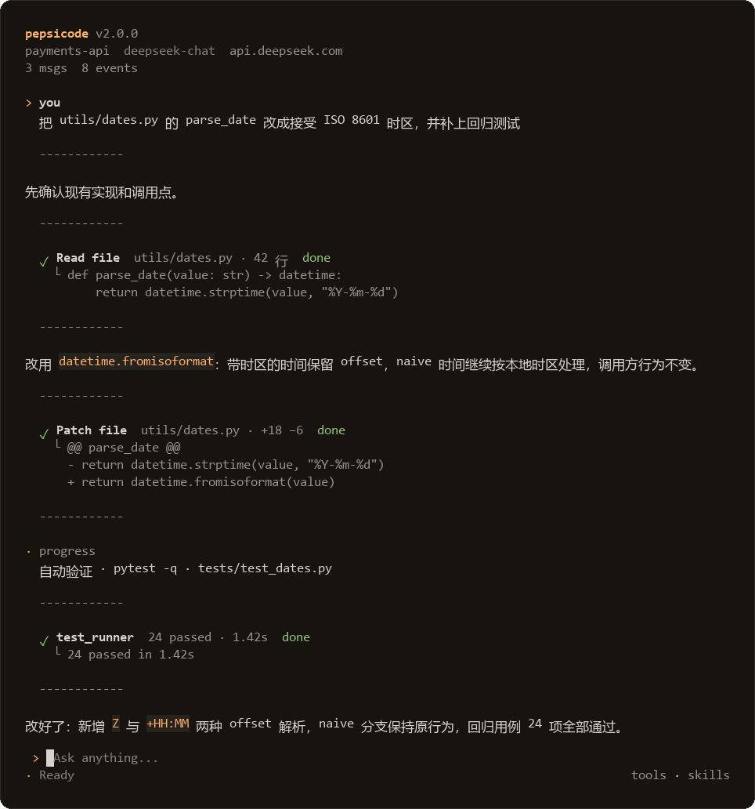

<div align="center">

# pepsicode

**把「想清楚 → 改完 → 验证通过」走完一遍的本地编程代理**

终端全屏 TUI 与 Electron 桌面客户端共用同一套代理内核：权限感知的工具、只读 Plan、可审计的 Hooks v2、MCP / Skills / 子代理，以及修改后的自动验证与修复。

[](docs/release-candidate.md)


[](LICENSE)
[](docs/configuration.md#模型配置)
[](docs/features.md#内置工具)
[](https://github.com/peps1666/pepsicode/actions/workflows/ci.yml)

[快速开始](#快速开始) · [功能速览](#功能速览) · [文档](#文档) · [权限与安全](docs/permissions.md) · [开发与验证](docs/development.md)

</div>

<p align="center">
  
  <br>
  <sub>终端界面：从定位、打补丁到自动验证并交付的完整链路</sub>
</p>

> **English summary** — pepsicode is a Python coding agent for local development workflows, usable from a full-screen terminal UI or an Electron desktop client. It ships 38 built-in tools, LSP-backed code intelligence, an automatic verify-and-fix loop, permission modes with a read-only Plan mode, project-trusted Hooks v2, MCP / Skills / sub-agents, context compaction, multi-provider model switching, and a token-authenticated WebSocket server.

## 这是什么

> **状态：** 当前源码是 **2.0.7 开发候选**，尚未创建对应发行标签，也未完成该候选的 Windows ZIP 成品验收。用 `pepsicode --version` 核对提交与 dirty 状态；详见 [2.0.7 开发候选](docs/release-candidate.md) 和 [已知问题](docs/project-issues.md)。

pepsicode 是一个面向本地开发工作流的 Python 编程代理。它有两种前端、一个内核：既能作为终端里的全屏交互程序使用，也能作为白色主题的桌面应用启动，两者共享同一套工具、权限、Hook 与上下文机制。

它和「只会补全代码」的助手不同的地方在于**闭环**：修改文件后按项目约定跑检查，把失败输出送回模型继续修，修不动就停并交还用户；每个动作都在权限模式、Hooks v2 和可选的语言服务约束下执行；一次会话可以直接切分支重试另一套方案，而原始路线仍然留在历史里。

`规划（可选） → 执行 → 验证 → 交付 / 继续修`

## 快速开始

需要 **Python 3.11+**。在仓库根目录执行：

```powershell
git clone https://github.com/peps1666/pepsicode.git
cd pepsicode
python -m pip install -e ".[dev]"
python -m pepsicode --install   # 首次配置服务商/模型
pepsicode
```

首次启动也可以直接输入 `/provider` 选择服务商、填写 API Key 和模型；配置会写入 `~/.pepsi-code/settings.json`。

需要虚拟环境、mock 模式、配置诊断、桌面端构建或便携包说明，见 [安装与启动](docs/getting-started.md) 和 [快速上手指南](ONBOARDING.md)。

> 默认使用 `auto`。`命令免确认` 会以当前用户权限放行任意本地程序，只在信任当前任务时启用；详见 [权限与安全](docs/permissions.md)。

## 功能速览

| 能力 | 说明 | 详情 |
| --- | --- | --- |
| 双前端 | 终端全屏 TUI + Electron 桌面客户端，共享代理内核与权限 | [桌面客户端](docs/desktop.md) |
| 代码理解与修改 | LSP 导航、跨文件重命名、diff 先行的编辑工具族、搜索与文件树 | [功能与工作流](docs/features.md#代码理解与修改) |
| 自动验证闭环 | 发现 tests / lint / build，失败回送模型修复，报告可追溯 | [质量闭环](docs/features.md#质量闭环) |
| 权限与 Plan | 四档权限（含命令免确认）、只读 Plan、工作区默认、外部路径/MCP 审批 | [权限与安全](docs/permissions.md) |
| 扩展与自动化 | Hooks v2、MCP、Skills、四类子代理、Markdown 自定义命令 | [Hooks v2](docs/hooks.md) · [扩展](docs/extensions.md) |
| 上下文与会话 | artifact、压缩、分支/恢复、持久记忆、成本与用量 | [模型、上下文与配置](docs/configuration.md) |

## 文档

| 文档 | 内容 |
| --- | --- |
| [快速上手指南](ONBOARDING.md) | 源码安装、Windows ZIP、常见启动故障 |
| [安装与启动](docs/getting-started.md) | Python / venv、命令入口、mock 模式、配置诊断 |
| [功能与工作流](docs/features.md) | 完整能力清单、38 个内置工具、子代理、记忆、队列、分支、Plan |
| [权限与安全](docs/permissions.md) | 四档权限、工作区默认、审批边界与高风险说明 |
| [模型、上下文与配置](docs/configuration.md) | 服务商、模型、思考档位、环境变量、上下文管理 |
| [Hooks v2](docs/hooks.md) | 配置层级、事件、动作、条件模板、管理命令、Python API |
| [扩展与自动化](docs/extensions.md) | Markdown 自定义命令、Skills 与 MCP |
| [桌面客户端](docs/desktop.md) | 架构、开发模式、模型配置、Windows ZIP 构建 |
| [命令速查](docs/commands.md) | 终端与桌面共用的常用斜杠命令 |
| [设计与开发](docs/development.md) | 设计取舍、测试、构建、真实任务评测 |
| [提交规范](docs/CONTRIBUTING.md) | 提交信息、分支命名与提交前检查 |
| [执行边界](docs/harness-boundaries.md) | 审批、执行所有权、恢复与并发边界 |
| [已知问题](docs/project-issues.md) | 当前限制、修复记录与验收清单 |

## 设计取舍

优先保证**副作用前审批、失败可见、上下文有界、配置显式**。关键 Hook 在权限检查前确定性阻断；无测试、被拒绝或未执行的检查都不会被算作通过；模型、思考档位和上下文容量都以接口或显式配置为准。完整说明见 [设计与开发](docs/development.md)。

## License

MIT，见 [LICENSE](LICENSE)。
