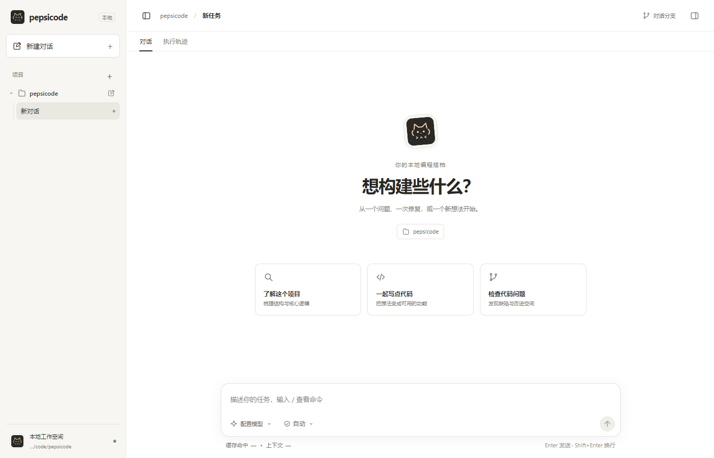

# Electron 桌面客户端

> 白色主题桌面客户端、WebSocket 服务端与 Windows ZIP 构建。

[← 返回 README](../README.md)

pepsicode 提供一个独立的 Electron 桌面应用，采用白色主题界面，体验类似 Codex / Claude Desktop，可以在图形界面里选择项目文件夹并与代理对话。

<p align="center">
  
  <br>
  <sub>桌面客户端：项目列表、任务入口和底部的模型与权限选择</sub>
</p>

## 架构

| 位置 | 组件 | 职责 |
| --- | --- | --- |
| 前端 | **Electron 桌面客户端**（React + Vite） | 白色主题 UI、项目文件夹选择、会话列表、流式消息、权限审批弹窗 |
| 通道 | **WebSocket · JSON-RPC**（`ws://127.0.0.1:<port>`） | 客户端发请求，服务端回流式事件与权限请求；建会话前必须令牌认证 |
| 后端 | **Python 服务端**（`pepsicode.server`） | Agent Loop、工具 / Skills / MCP、权限模式与 Hooks v2、上下文管理 |

Electron 主进程在启动时自动拉起 Python WebSocket 服务端，前端通过 `ws://127.0.0.1:<port>` 连接后端，使用 JSON-RPC 信封通信，支持流式事件（`message/delta`、`tool/call`、`tool/result` 等）和权限请求。

连接在创建会话前必须完成令牌认证，并校验 WebSocket Origin。Electron 自动生成本次启动专用的随机令牌，通过受限 IPC 交给主窗口，不放进 URL 或日志。Python 子进程继承用户的厂商 Key、模型设置和自定义环境变量，同时移除 Electron/Chromium 的运行时注入变量；可用 `PEPSI_PYTHON` 指定 Python 路径，也可使用当前 PATH 中的 Python。

独立启动服务端时，先设置 `PEPSI_CODE_SERVER_TOKEN`，例如在 PowerShell 中：

```powershell
$env:PEPSI_CODE_SERVER_TOKEN = python -c "import secrets; print(secrets.token_urlsafe(32))"
python -m pepsicode.server --port 8765
```

自定义客户端连接后的第一帧必须为 `{"kind":"request","id":0,"method":"connection/auth","params":{"token":"本次配置的令牌"}}`；收到 `authenticated: true` 后再发送业务请求。默认接受无 Origin 的本机客户端，以及 Origin 为 `null` 或 `file://` 的桌面文件页面，均必须认证。浏览器开发页面须通过 `PEPSI_CODE_SERVER_ORIGINS` 显式配置允许的 Origin（JSON 字符串数组，不接受 `*`）；Electron 开发模式会自动配置其开发地址。

## 环境要求

- Node.js 18+
- Python 3.11+（同 CLI 要求）
- 已安装 pepsicode 包（`pip install -e .`）

## 构建与启动

```bash
cd pepsicode-client
npm install
npm run build      # 构建前端 (dist/) 和 Electron 主进程 (dist-electron/)
npm start          # 启动桌面应用
```

开发模式（热重载）：

```bash
# 终端 1：启动 Vite dev server
PEPSI_DEV_SERVER=1 npm run dev

# 终端 2：启动 Electron（连热重载）
npm start
```

## 选择项目文件夹

侧边栏按「项目 → 对话」组织。点击「项目」右侧的 `+` 选择文件夹，添加的项目及展开状态会在本机保留；同一目录不会重复添加。每个项目旁的新建按钮用于在该目录中开启独立对话，顶部「新建对话」则使用当前项目。

点击项目可展开或折叠它的对话列表，点击对话会恢复历史，并把工具执行、文件读写、命令运行的 cwd 切换到所属项目。已有对话继续按项目保存，任务运行期间不能切换项目或对话。

## 模型配置

桌面客户端共用同一套配置文件（`~/.pepsi-code/settings.json`），模型和 API Key 的读取优先级与 CLI 一致（见下方[模型配置](configuration.md#模型配置)章节）。

输入框底部左侧显示当前模型与思考深度。点击可从当前 API 返回的模型列表中选择，显示名称与请求 ID 分别读取；思考档位来自接口的能力元数据。可点击「刷新模型列表」重新读取。点击「应用」后从下一轮生效，保留聊天记录与费用统计；当前轮执行期间禁止切换。

默认只修改当前会话，设置随下一轮对话一同自动保存，恢复会话时会恢复服务商、模型与思考深度。勾选「同时保存为新会话默认设置」会写入 `~/.pepsi-code/settings.json`；环境变量依然具有更高优先级。在 `providers` 中配置四家的独立凭据后，可在同一对话中切换服务商。Mock 模式下该入口禁用。

## 打包为 Windows ZIP 便携版

```bash
cd pepsicode-client
npm ci
npm run release:zip
# 兼容入口：npm run electron:build
```

构建需要 Windows 10/11 x64、Python 3.12 和 Node.js 22+。脚本会在 `build/desktop-venv` 创建隔离构建环境，将 Python 后端、依赖和内置 agent 资源一起打包，使用 Windows 自带的 .NET Framework 编译小型启动器，然后输出 `pepsicode-client/release/Pepsicode-2.0.7-win-x64.zip` 与 `.sha256` 校验文件。ZIP 发布前会检查内部文件 CRC。

使用者完整解压 ZIP 后双击 `Pepsicode.exe` 即可，无需安装 Python、Node；首次打开在界面配置自己的模型服务商和 API Key。项目自身需要的 Git、测试运行时、语言服务器等仍使用该项目的开发环境。配置与会话保存在用户目录，免安装不表示所有数据都保存在解压目录中。初版 ZIP 未签名。

成品验收命令（在仓库根目录运行）：

```powershell
.\build\desktop-venv\Scripts\python.exe scripts/smoke_desktop_zip.py pepsicode-client/release/Pepsicode-2.0.7-win-x64.zip
cd pepsicode-client
npm run release:smoke
```

这两项验收分别检查真实后端协议、真实桌面窗口及退出清理，均在中文和空格目录中解压运行，隔离用户数据，并从 PATH 移除 Python / Node。[TDD 实施与验收记录](windows-zip-tdd.md)列出了每一步的任务、注意事项和验证边界。GitHub Actions 的 `Windows ZIP` 工作流可手动生成并上传构建 artifact；不会自动发布 GitHub Release。
